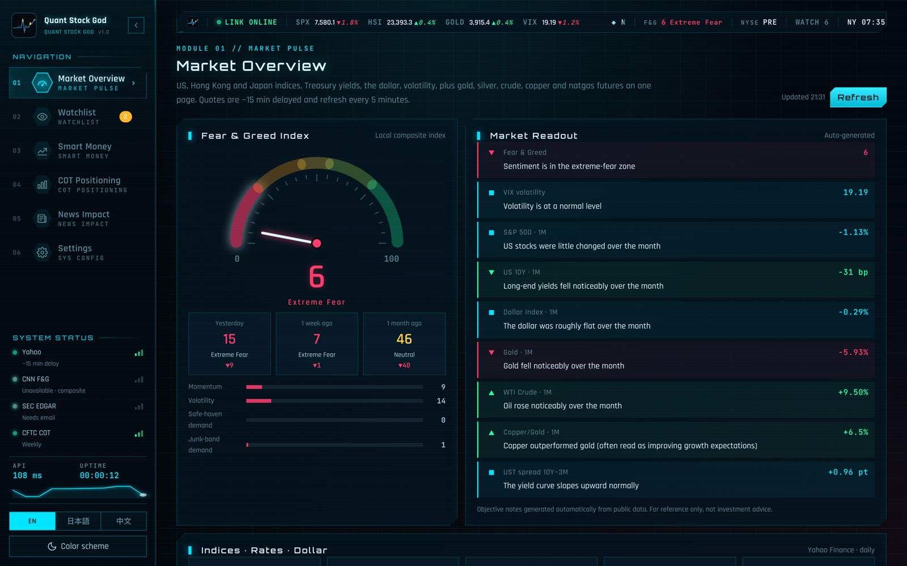
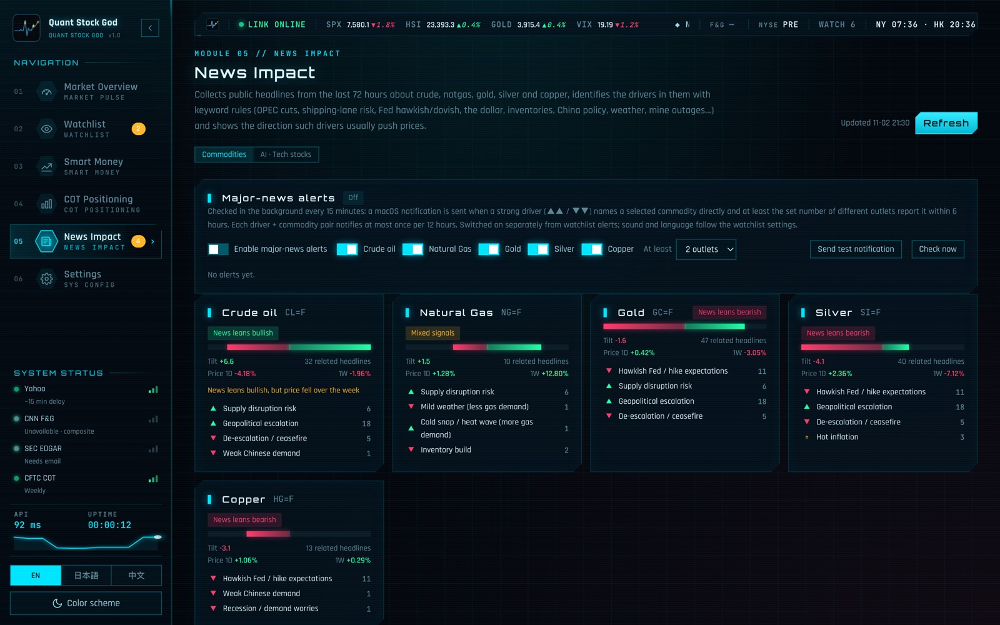
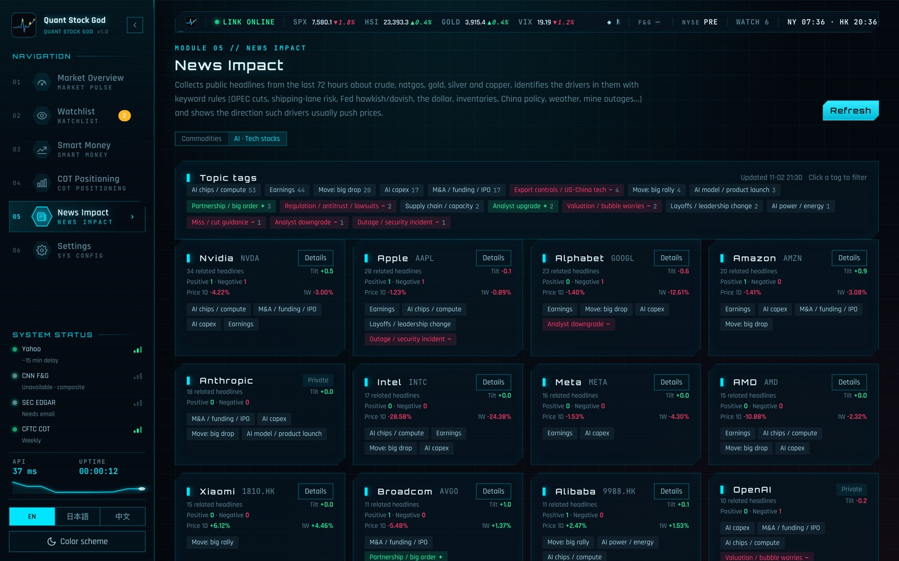
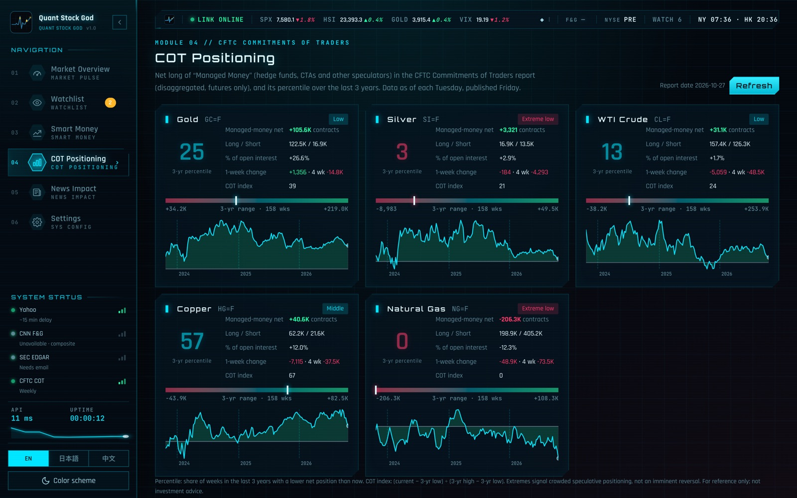

# 量化株神（Quant Stock God）— ローカルで動く米国株・香港株・商品マーケット監視ツール

[English](README.md) · 日本語 · [中文](README.zh.md) · ライセンス：[AGPL-3.0](LICENSE) · [セキュリティ](SECURITY.md) · [サードパーティ](THIRD_PARTY_NOTICES.md) · 作者：[@FuturEvoLab](https://x.com/FuturEvoLab)

**オンラインデモ：** https://futurevolab.github.io/quant-stock-god/?lang=ja （インストール不要。記録済みのデータスナップショットを閲覧できます）

米国株・香港株・株価指数・金利・ドル・金・原油などの商品先物を 1 つの画面で監視し、ウォッチリストの急変、インサイダーの買い、ヘッジファンドの建玉、エネルギー在庫、ニュースの材料までを、すべて自分のパソコンの中だけで分析するツールです。

- **外部ライブラリ不要**：バックエンドは Python 標準ライブラリのみ、フロントエンドは素の JavaScript です。pip もビルドも不要で、Python 3 があれば動きます。
- **データはローカルに保存**：API キーや設定、ウォッチリストは自分の PC の `data/` にだけ保存され、外部サーバーには送りません。
- **3 言語の UI**：English（既定）・日本語・中文。配色は ブルー HUD / ブラックゴールド / ライト の 3 種類。
- **無料データのみ**：有料データや有料 API は使いません（任意で無料の FRED / EIA キーを追加できます）。

> **免責事項**：本ツールは個人の学習・研究用です。相場解説、ニュース傾向、統計はいずれも公開データとルールに基づく自動生成の記述であり、誤りや遅延を含む可能性があります。**投資助言ではありません。** 一部のデータ取得先は非公式のエンドポイントです。利用は自己責任で、各国の法令と各データ提供元の利用規約に従ってください。

## スクリーンショット

## 主な機能

| 機能 | 内容 |
|---|---|
| マーケット概況 | 恐怖と強欲指数（CNN が使えない場合は独自の合成指数）、VIX、S&P 500、Nasdaq、ハンセン、日経 225、米国債 10 年、ドル指数、金・銀・WTI・ブレント・銅・天然ガス先物。1D / 1W / 1M の騰落率とスパークライン、客観的な「マーケット解説」を自動生成します。米国債の利回り曲線と 10Y−3M / 10Y−2Y スプレッドも表示します。 指数・金利・ドル・商品の間の相関係数（1 か月 / 1 四半期 / 1 年の日次リターン）をヒートマップで表示します。 |
| ウォッチリスト | 米国株・香港株（`0700.HK`）・先物（`GC=F`）・指数（`^HSI`）。騰落率、出来高（20 日平均比）、RSI の買われ過ぎ / 売られ過ぎへの突入、52 週高値 / 安値をバックグラウンドで監視し、macOS / Windows に通知します。 銘柄ごとに目標価格も設定でき、その価格を当日に上抜け / 下抜けしたときに通知します。 列はクリックで並べ替えでき、「vs SPX · 1M」列で S&P 500 に対する相対強弱を表示。リストは JSON でエクスポート / インポートでき（API キーは含まない）、設定時刻にデイリーサマリー通知を送ることもできます。 |
| 銘柄詳細 | 終値チャートと 20 / 50 / 200 日移動平均、出来高、RSI(14)、ボラティリティ、最大ドローダウン、技術面の要点（売買判断はしません）。 |
| スマートマネー（SEC EDGAR） | **Form 4**：インサイダーの市場での買付（コード P）を集め、買付後 30 / 90 日のリターン、S&P 500 比の超過リターン、人ごとの的中率を算出。**13F**：著名ファンドの四半期ごとの新規・買い増し・一部売却・全売却を、ファンド ↔ 銘柄のグラフで表示します。 |
| 商品ポジション | CFTC 建玉明細（COT）のマネージドマネー純建玉と過去 3 年の百分位、EIA 週報（原油・ガソリン・留出油・クッシング・天然ガス在庫）と過去 5 年同期の比較。 |
| ニュース影響 | 無料 RSS から直近 72 時間の見出しを集め、約 28 のキーワードルール（OPEC+、航路リスク、FRB のタカ派 / ハト派、ドル、在庫、中国の政策、天候、鉱山の操業停止など）で材料と通常の影響方向を判定し、商品ごとの「ニュース傾向」を実際の値動きと並べて表示します。複数媒体が報じた強い材料は通知できます。**AI・テック株**ビューでは約 25 社 × 19 トピックでタグ付けします。 |
| 事後検証 | 毎日のニュース傾向を記録し、翌日 / 5 取引日後の実際の方向と照合して的中率を基準（上昇日の割合）と比較します。 |

## 技術的なポイント

- **依存ゼロのフルスタック構成**：`ThreadingHTTPServer` ベースの Python サーバーと、Vanilla JS + Cytoscape.js のフロントエンド。ビルド工程はありません。
- **10 以上の無料データ源の統合**：Yahoo Finance、SEC EDGAR、CFTC Socrata、EIA、FRED、Google News RSS、Federal Reserve、CNBC など。データ源ごとにレート制限、429 時のクールダウン、キャッシュを実装しています。
- **体感速度**：メモリとディスクの 2 段キャッシュに stale-while-revalidate とリクエストの一本化を組み合わせ、期限切れ後の表示を約 4.7 秒から 0.06 秒に短縮しました。
- **通知の信頼性**：遅れて配信されるニュースも取りこぼさないよう「初めて見た時刻」で新着を判定し、同じ材料は 12 時間に 1 回だけ通知します。休場中の古い相場では通知しません。
- **セキュリティ**：Host / Origin の検証、書き込みには独自ヘッダーを必須化（CSRF 対策）、CSP によるインラインスクリプト禁止、クリックジャッキング対策、XML エンティティの拒否、リモート応答のサイズ上限。詳細は [SECURITY.md](SECURITY.md)。
- **静的デモ**：`fetch` を差し替えて記録済みデータで応答し、バックエンドなしで GitHub Pages 上で動かしています（`tools/build_demo.py`。個人データやキーは含めず、空のデータフォルダで記録）。
- **テスト**：ネットワーク不要の自動テスト 48 件（ニュースルールの誤判定回帰、指標計算、通知判定、セキュリティ）。
- **運用**：macOS は launchd、Windows はスタートアップで常駐。画面からワンクリックで再起動でき、コードが変わると画面に通知が出ます。

## はじめ方

Python 3.9 以上が必要です（Windows ではインストール時に「Add Python to PATH」にチェック）。

| OS | 手動で起動 | 自動起動を設定 | 自動起動を解除 |
|---|---|---|---|
| macOS | `Start-QuantStockGod.command` | `Enable-Autostart-macOS.command` | `Disable-Autostart-macOS.command` |
| Windows | `Start-QuantStockGod.bat` | `Enable-Autostart-Windows.bat` | `Disable-Autostart-Windows.bat` |

ダブルクリックするとブラウザで <http://127.0.0.1:8767> が開きます。コマンドラインからは `python3 server.py`（ポートは `PORT=8770 python3 server.py` のように変更可能）。

macOS で初めて開くとき「開発元を確認できない」と表示された場合は、ファイルを右クリック →「開く」→ 確認してください。Windows の SmartScreen が表示された場合は「詳細情報 → 実行」を選びます。

### 任意の設定（すべて無料）

画面の「設定」で入力します。値は自分の PC の `data/config.json` にだけ保存され、画面には再表示されません。

| 項目 | 用途 | 未設定の場合 |
|---|---|---|
| SEC 連絡先メール（ご自身のもの） | SEC は各リクエストの User-Agent に連絡先を含めるよう求めています | スマートマネー（Form 4 / 13F）が使えません |
| FRED API キー | 2 年債、FF 金利、期待インフレ率、ハイイールド債スプレッド、CPI、失業率 | Yahoo の米国債利回りのみ表示 |
| EIA API キー | エネルギー在庫週報 | 公開 DEMO_KEY を使用（制限あり） |

## 制限事項

- Yahoo Finance と CNN のエンドポイントは非公式で、予告なく変更・制限される可能性があります。CNN は非ブラウザからのアクセスを拒否するため、通常は合成指数が表示されます。
- 相場は約 15 分遅延です。13F は四半期末から最大 45 日遅れで、CUSIP から銘柄コードへの変換はまだありません。
- ニュースの判定はキーワードルールであり予測ではありません。見出しは英語の原文のまま表示します。
- 香港の南向き資金フロー、香港のインサイダー開示は今後の予定です。

より詳しい仕様と制限は中国語版 [README.zh.md](README.zh.md) にあります。

## ライセンスと連絡先

- コード：[GNU AGPL-3.0](LICENSE)。同梱フォントとライブラリのライセンスは [THIRD_PARTY_NOTICES.md](THIRD_PARTY_NOTICES.md) を参照してください。
- 連絡・フィードバック：X（Twitter）[@FuturEvoLab](https://x.com/FuturEvoLab)。セキュリティ上の問題は [SECURITY.md](SECURITY.md) の手順で非公開でご報告ください。
- 本プロジェクトは AI ペアプログラミング（Claude Code）の支援を受けて開発しました。機能設計・要件定義・判断・レビューは FuturEvoLab が行っています。
