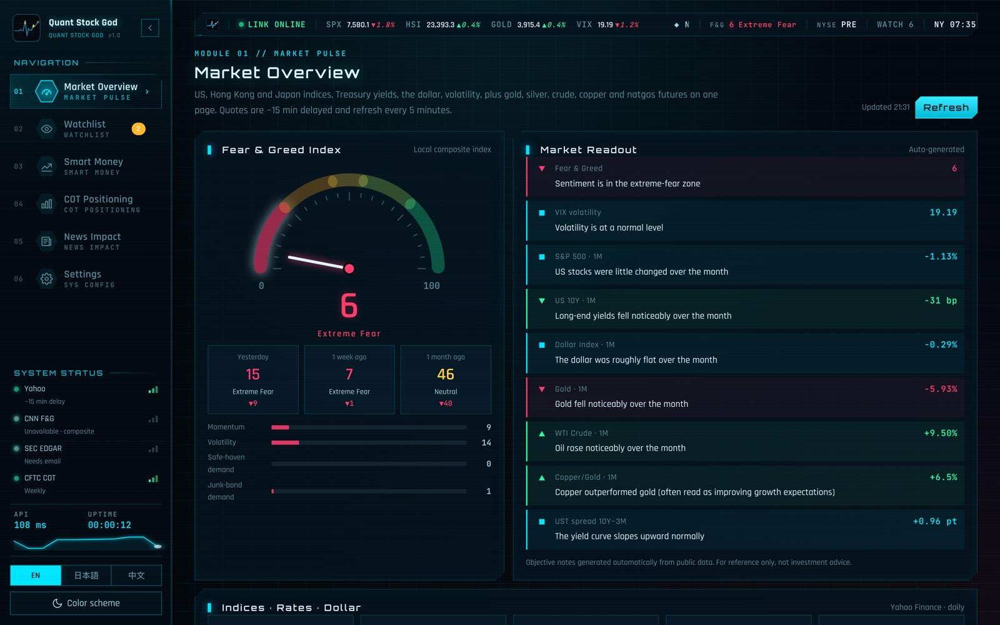
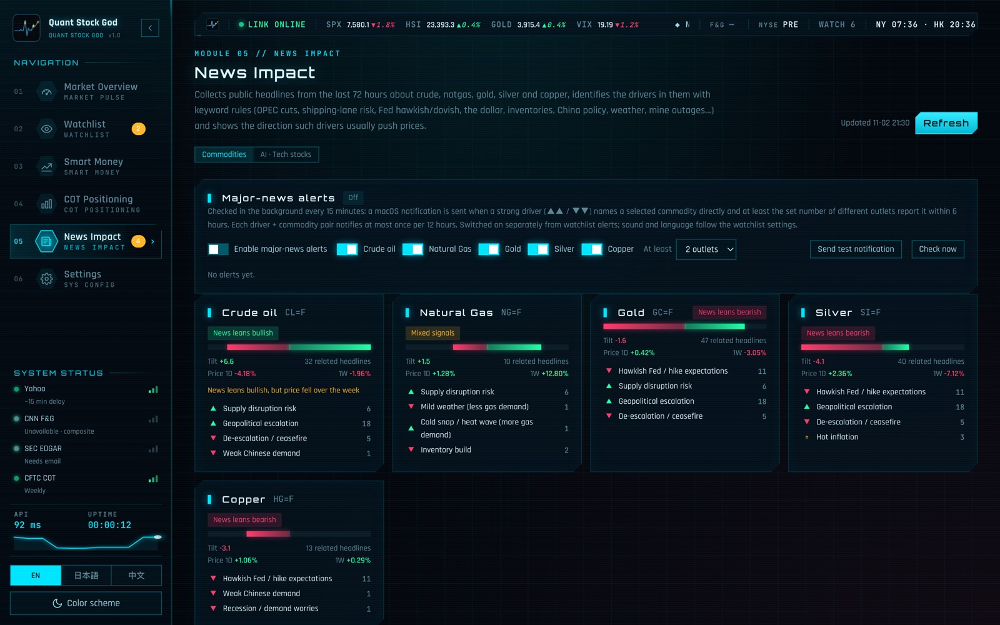
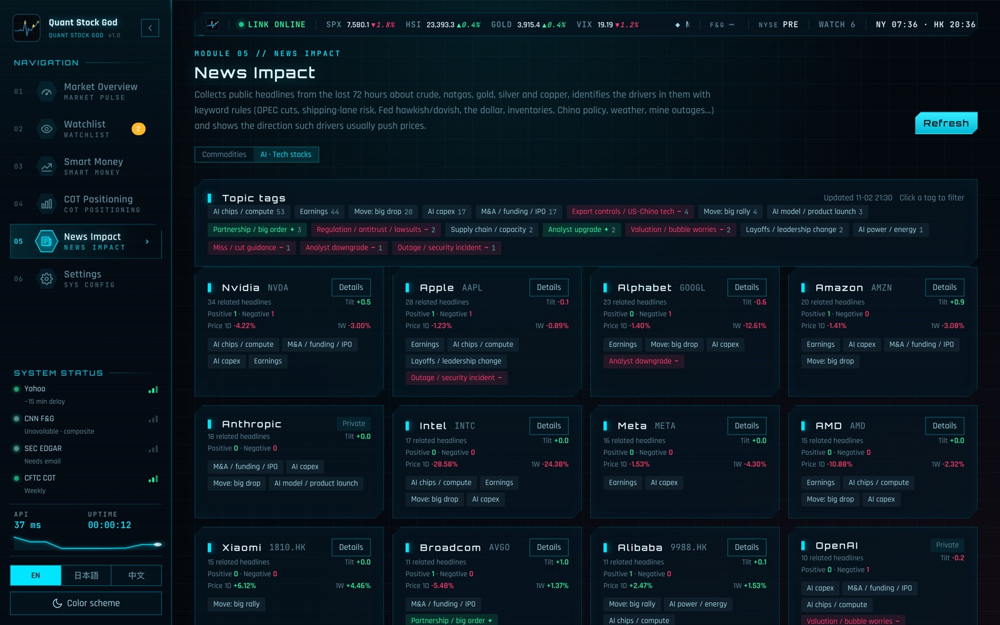
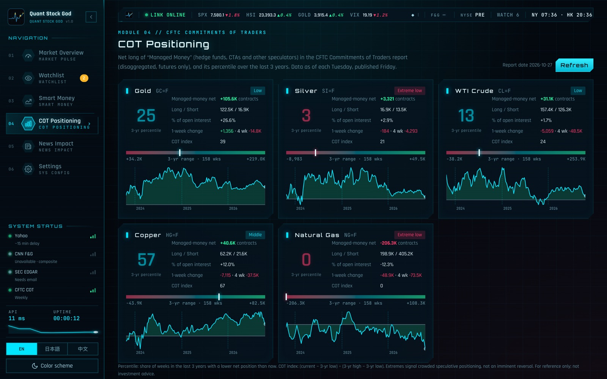

# Quant Stock God (量化股神) — a local monitor for US / HK stocks and commodities

English · [日本語](README.ja.md) · [中文](README.zh.md) · License: [AGPL-3.0](LICENSE) · [Security](SECURITY.md) · [Third-party notices](THIRD_PARTY_NOTICES.md) · Author: [@FuturEvoLab](https://x.com/FuturEvoLab)

[](https://github.com/FuturEvoLab/quant-stock-god/actions/workflows/tests.yml)

**Online demo:** https://futurevolab.github.io/quant-stock-god/?lang=en (no install; browse a recorded data snapshot)

Watch US and Hong Kong stocks, indices, rates, the dollar, gold, oil and other commodity futures on one screen. The tool also tracks watchlist alerts, insider buying, hedge-fund positioning, energy inventories and news drivers, and everything runs on your own computer.

- **No dependencies.** The backend is the Python standard library only and the front end is plain JavaScript. There is no pip install and no build step; Python 3 is enough.
- **Your data stays local.** API keys, settings and the watchlist live only in `data/` on your machine.
- **Three UI languages:** English (default), Japanese and Chinese. Three color schemes: blue HUD, black-gold and light.
- **Free data only.** You can optionally add free FRED and EIA keys.

> **Disclaimer.** This tool is for personal learning and research. Market readouts, news tilt and statistics are generated automatically from public data and rules and may be wrong or delayed. **This is not investment advice.** Some data sources are unofficial endpoints. Use it at your own risk and follow your local laws and each data provider's terms of service.

## Screenshots









## Features

| Module | What it does |
|---|---|
| Market overview | Fear & Greed (CNN, or a local composite when CNN is unavailable), VIX, S&P 500, Nasdaq, Hang Seng, Nikkei 225, US 10Y, the dollar index, plus gold, silver, WTI, Brent, copper and natgas futures. Each shows 1D / 1W / 1M changes and a sparkline. An objective readout is generated automatically, alongside the Treasury yield curve and the 10Y−3M / 10Y−2Y spreads. A cross-asset correlation heatmap (Pearson correlation of daily returns over 1 month / 1 quarter / 1 year) shows how the indices, rates, the dollar and commodities have been moving relative to each other. |
| Watchlist | US stocks, HK stocks (`0700.HK`), futures (`GC=F`) and indices (`^HSI`). Price moves, volume versus the 20-day average, RSI crossing 70/30 and 52-week highs/lows are checked in the background, with macOS / Windows notifications. Each symbol can also carry price targets: a notification is sent on the day the price crosses above or below the level. Columns are sortable, a "vs SPX · 1M" column shows relative strength against the S&P 500, the list can be exported / imported as JSON (no keys), and an optional daily digest notification summarises the market and your watchlist at a set time. A 20/50-day moving-average golden / death cross can also notify. |
| Portfolio | Record holdings (symbol, shares, average cost) and see market value, P&L, today's change and weights, with non-USD positions converted to USD using Yahoo FX rates. Stored only in `data/positions.json`; included in the JSON export. |
| Quant Lab | Backtest four simple long-only rules (buy & hold, 20/50-day MA cross, 200-day trend, RSI mean reversion) on 2 / 5 / 10 years of daily bars with fees, compared with buy & hold and split into first / second half for robustness. A volatility cone gives 68% / 95% price ranges 5–60 trading days ahead from the past year's volatility, the probability of reaching a target level, and a look-back check of how often those ranges actually held. Descriptive statistics, not forecasts. |
| Symbol detail | Close chart with 20/50/200-day averages, volume, RSI(14), volatility, max drawdown and objective technical notes (no buy/sell calls). |
| Smart money (SEC EDGAR) | **Form 4:** open-market insider purchases (code P), with 30/90-day returns, excess return vs the S&P 500 and per-insider hit rates. **13F:** quarter-over-quarter new / added / reduced / exited positions of well-known funds, drawn as a fund ↔ stock graph. |
| Commodity positioning | CFTC Commitments of Traders managed-money net positions with their 3-year percentile, and EIA weekly inventories (crude, gasoline, distillate, Cushing, natgas) versus the 5-year seasonal range. |
| News impact | Headlines from the last 72 hours via free RSS, tagged by about 28 keyword rules (OPEC+, shipping risk, hawkish/dovish Fed, dollar, inventories, China policy, weather, mine outages…), with the usual direction of impact and a per-commodity news tilt shown next to actual price moves. Optional notifications for strong drivers reported by several outlets. An **AI & tech** view tags headlines by roughly 25 companies × 19 topics. |
| After-the-fact check | The daily news tilt is recorded and later compared with the next-day and 5-day moves, against the base rate of up days. |

## Getting started

Python 3.9+ is required (on Windows, tick "Add Python to PATH" when installing).

| OS | Start manually | Enable autostart | Disable autostart |
|---|---|---|---|
| macOS | `Start-QuantStockGod.command` | `Enable-Autostart-macOS.command` | `Disable-Autostart-macOS.command` |
| Windows | `Start-QuantStockGod.bat` | `Enable-Autostart-Windows.bat` | `Disable-Autostart-Windows.bat` |

Double-click a launcher and your browser opens <http://127.0.0.1:8767>. From a terminal, run `python3 server.py` (change the port with `PORT=8770 python3 server.py`).

The first time on macOS, a downloaded launcher may be blocked as coming from an unidentified developer: right-click it, choose **Open**, then confirm. Windows SmartScreen may likewise ask you to click **More info → Run anyway**.

### Optional settings (all free)

Enter these on the Settings page. They are stored only in `data/config.json` on your machine and are never shown back on the page.

| Item | Used for | If not set |
|---|---|---|
| SEC contact email (your own) | SEC asks every request to carry a contact address in the User-Agent | Smart money (Form 4 / 13F) is unavailable |
| FRED API key | 2-year yield, fed funds, breakeven inflation, high-yield spread, CPI, unemployment | Only Yahoo Treasury yields are shown |
| EIA API key | Weekly energy inventories | Falls back to the rate-limited public DEMO_KEY |

## Limitations

- The Yahoo Finance and CNN endpoints are unofficial and may change or throttle without notice. CNN rejects non-browser clients, so the local composite index is usually shown.
- Quotes are about 15 minutes delayed. 13F data arrives up to 45 days after quarter-end, and CUSIPs are not yet mapped to tickers.
- News tagging is rule-based, not a forecast. Headlines are shown in their original English.
- Hong Kong southbound flows and HK insider disclosures are planned for a later version.

The full specification and limitations are in the Chinese [README.zh.md](README.zh.md).

## Online demo

The demo in `docs/` is a static copy of the UI that answers its API calls from a recorded snapshot, so it runs on GitHub Pages with no backend. `tools/build_demo.py` records the snapshot with a fresh, empty data folder (default watchlist, no keys, no personal data). Searching, settings and alerts are disabled, and Smart Money is not included because SEC requires a contact email. Rebuild it with `python3 tools/build_demo.py docs`. Link parameters: `?lang=en|ja|zh`, `?tab=market|watch|smart|cot|news|settings`, `?view=tech`, `?skin=gold|light`.

## Running the tests

```bash
python3 -m unittest discover tests
```

There are 58 offline tests (no network, no notifications). GitHub Actions runs them on every push (Ubuntu with Python 3.9 and 3.12, and macOS).

## License and contact

- Code: [GNU AGPL-3.0](LICENSE). Bundled fonts and libraries are listed in [THIRD_PARTY_NOTICES.md](THIRD_PARTY_NOTICES.md).
- Contact and feedback: X (Twitter) [@FuturEvoLab](https://x.com/FuturEvoLab). Please report security issues privately as described in [SECURITY.md](SECURITY.md).
- This project was developed with AI pair-programming assistance (Claude Code). Feature design, requirements, decisions and review are by FuturEvoLab.
