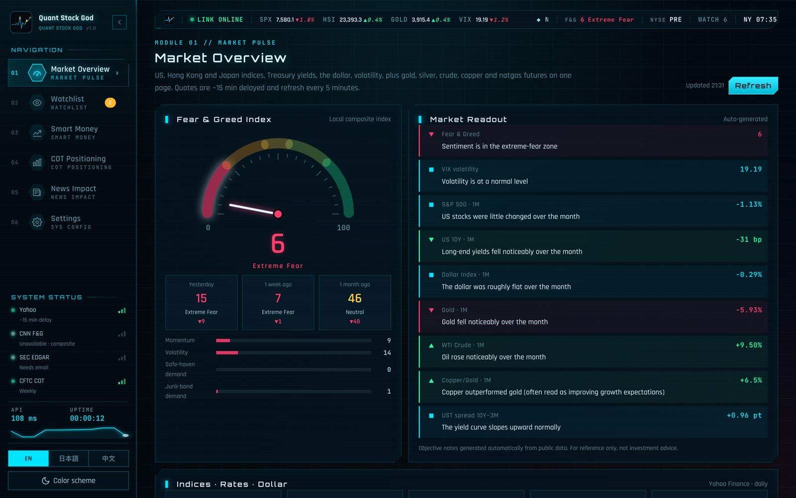
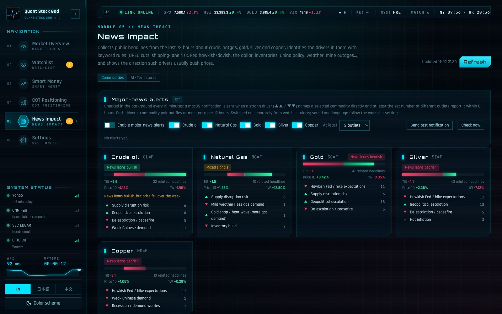
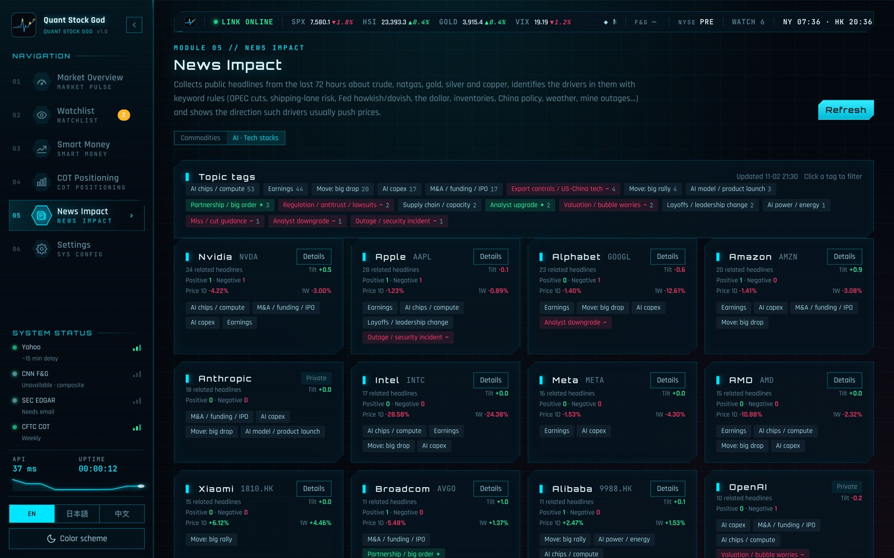
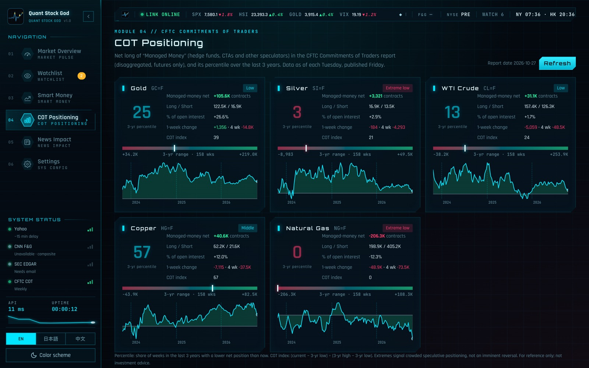

# 量化股神 · Quantriel

[English](README.md) · [日本語](README.ja.md) · 中文 · 许可证：[AGPL-3.0](LICENSE) · [安全说明](SECURITY.md) · [第三方组件](THIRD_PARTY_NOTICES.md) · 作者：[@FuturEvoLab](https://x.com/FuturEvoLab)

**在线演示：** https://quantriel.futurevolab.com/?lang=zh （无需安装，浏览录制好的数据快照）

本地运行的美股 / 港股 / 黄金原油大宗商品监控分析工具。Python 标准库服务端 + 原生 JS 前端（无需 pip、无需构建），HUD 深色主题，English / 日本語 / 中文 三语（默认英语）。界面风格与同一作者的「区块侦探 / Block Detective」一致。

> **免责声明：仅供个人本地学习研究使用，不构成任何投资建议。** 全部数据来自免费公开接口（其中一部分是非官方接口），可能延迟、缺失、出错或被限流；市场解读、新闻倾向等都是基于公开数据和规则的自动描述，可能有误。使用者需自行遵守所在地法律以及各数据源的服务条款，风险自负。

## 截图









## 启动

| 系统 | 手动启动（双击） | 开机自启（双击一次即可） | 取消开机自启 |
|---|---|---|---|
| macOS | `Start-Quantriel.command` | `Enable-Autostart-macOS.command` | `Disable-Autostart-macOS.command` |
| Windows | `Start-Quantriel.bat` | `Enable-Autostart-Windows.bat` | `Disable-Autostart-Windows.bat` |

- 打开 <http://127.0.0.1:8767>（建议加入浏览器书签）。设置了开机自启后，服务一直在后台运行，书签就是“一键打开”，自选异动和重大新闻提醒也一直有效。
- 手动启动脚本会先检查服务是否已在运行：在运行就直接打开浏览器，否则在当前窗口启动（关闭窗口即停止）。
- 需要 Python 3（3.9+），不需要 pip 安装任何东西。Windows 安装 Python 时请勾选 “Add Python to PATH”。
- 端口默认 8767。手动启动时端口被占会自动换下一个空闲端口；命令行可用 `PORT=8770 python3 server.py` 指定。
- macOS 第一次打开下载来的启动文件时，如果提示“无法验证开发者”，请右键点击文件 → 选“打开” → 再确认一次。Windows 弹出 SmartScreen 时点“更多信息 → 仍要运行”。
- 日志：macOS 开机自启在 `~/Library/Logs/QuantStockGod/server.log`；Windows 开机自启（无窗口）在 `data/server.log`。
- **改代码后怎么看效果**：只改了 `static/` 里的界面文件，刷新网页即可；改了 `server.py`，点设置页“服务”里的“重启服务”，或页面顶部出现的“服务端代码已更新”提示条上的按钮，几秒后页面会自动刷新。服务每 15 秒检查一次文件修改时间，有改动就会出现提示条。
- Windows 版的启动脚本和系统通知（PowerShell toast）是按 Windows 10/11 写的，还没有在 Windows 上实际测试过。

## 需要准备的东西（都免费，可选）

| 项目 | 用途 | 不填会怎样 |
|---|---|---|
| SEC 联系邮箱（你自己的） | SEC 要求每个请求的 User-Agent 带联系邮箱；只用于向 SEC 表明身份，只存在你本机的 `data/secrets.json` | “聪明钱”（Form 4 / 13F）无法使用 |
| FRED API Key | 宏观数据（2 年期、联邦基金利率、通胀预期、高收益债利差、CPI、失业率） | 只显示 Yahoo 的美债收益率 |
| EIA API Key | 能源库存周报 | 使用公共 DEMO_KEY，偶尔被限流 |

都在网页的“设置”页填写。

## 功能模块

| 模块 | 内容 |
|---|---|
| 01 市场总览 | 恐惧与贪婪指数（仪表 + 走势）、VIX、S&P 500、Nasdaq、恒生、日经 225、美债 10Y、美元指数；黄金、白银、WTI、布伦特、铜、天然气期货。每项显示 1D / 1W / 1M 涨跌和走势小图，并自动生成客观的“市场解读”。点击任一卡片打开品种详情。**宏观卡片**：美债收益率曲线（现在 vs 1 个月前）、10Y−3M / 10Y−2Y 利差；填写 FRED Key 后增加 2 年期、联邦基金利率、10 年通胀预期、高收益债利差、CPI 同比、失业率。新增跨资产相关性热力图：指数、利率、美元、商品两两的日收益率相关系数（1 个月 / 1 季度 / 1 年）。**港股通南向资金卡片**：内地资金每日净买入港股的金额（近 30 个交易日柱状图，沪 / 深两条通道，近 5 / 20 日合计，连续净买入 / 净卖出天数），当日成交额前 10 的股票和近 5 日净买入排行；点击股票打开品种详情。|
| 02 自选监控 | 美股、港股（`0700.HK`）、期货（`GC=F`）、指数（`^HSI`）。每个品种可设涨跌幅阈值（%）和放量倍数（对比 20 日均量），还可以分别开关两类技术提醒：**RSI 超买 / 超卖**（RSI(14) 当天升破 70 或跌破 30，且昨天收盘时还不在该区间，所以停在区间里不会每天重复提醒）和 **52 周新高 / 新低**（现价高于此前 252 个交易日的最高收盘价，或低于最低收盘价；默认都开启）。列表显示 RSI(14) 和 52 周区间位置。后台线程定时检查，触发时发 macOS 通知；带“发送测试通知”按钮。每个品种还可以设目标价（≥ / ≤），当天穿越时提醒。表头可点击排序，「vs SPX · 1M」列显示相对标普 500 的强弱；自选和基金列表可导出 / 导入 JSON（不含密钥）；可开启每日摘要通知，每天定时推送一条市场和自选概况。20 / 50 日均线金叉 / 死叉也可提醒。|
| 03 持仓盈亏 | 记录持仓（代码、股数、平均成本），显示市值、盈亏、当日盈亏和权重；非美元品种按 Yahoo 汇率折成美元合计。只保存在本机 `data/positions.json`，随 JSON 导出一起备份。|
| 04 量化实验室 | 对任意代码回测四种只做多的简单规则（买入持有、20/50 日均线金叉死叉、200 日趋势、RSI 均值回归），2 / 5 / 10 年日线、含手续费，与买入持有对比并分前后两段看稳定性。统计区间按过去一年波动率给出 5～60 个交易日的 68% / 95% 价格区间、到达目标价的概率，并回看过去一年检验区间的实际覆盖率。是统计描述，不是预测。预测检验：历史相似情形之后的收益分布、只用价格特征的逻辑回归模型在样本外的命中率（与基准对比、Brier 分数、校准）、按月份和星期的季节性。|
| 品种详情 | 点击自选列表的行或市场总览的卡片打开：近 3M / 6M / 1Y 收盘价走势 + 20 / 50 / 200 日均线 + 成交量 + RSI(14)，悬停看每日读数；1W～1Y、YTD 收益，52 周高低点，距各均线的偏离，20 日 / 1 年年化波动率，1 年最大回撤，以及客观的“技术面要点”（不给买卖判断） |
| 03 聪明钱 | **Form 4 内部人买入**：输入美股代码，扫描最近 N 份 Form 4，只取交易代码 P（公开市场买入），计算每笔买入后 30 / 90 天收益、相对 S&P 500 的超额收益，以及每位内部人的 90 天命中率。**13F 机构持仓**：可配置的基金列表（默认 Berkshire、Scion、Pershing Square、Appaloosa、Duquesne、Baupost、Third Point、Tiger Global），对比最近两个季度的新建仓 / 加仓 / 减仓 / 清仓，用 Cytoscape 画基金 ↔ 股票关系图 |
| 04 商品持仓 | CFTC COT（细分版、仅期货）黄金、白银、WTI 原油、铜、天然气的“管理资金”净持仓、周变化、占总持仓比例，以及在最近 3 年中的百分位和 COT 指数。**EIA 库存周报**：美国原油（不含 SPR）、汽油、馏分油、库欣原油、天然气（48 州）库存，周变化、同比，以及和过去 5 年同一周的均值 / 区间比较 |
| 05 新闻影响 | 抓取最近 72 小时与原油、天然气、黄金、白银、铜相关的公开新闻标题，用约 28 条关键词规则识别驱动因素（OPEC+ 增减产、航道 / 供应中断、地缘冲突与停火、制裁、库存、美联储鹰鸽、通胀、美元、中国刺激 / 需求、关税、衰退担忧、飓风、寒潮 / 温和天气、LNG、矿山停产、央行购金、ETF 资金流、战略储备等），标出每条消息通常对各商品的影响方向和传导逻辑；按商品汇总“新闻倾向”（时间衰减、同一因素最多计 4 条），并和实际 1D / 1W 涨跌对照。页面底部可展开全部规则。**重大新闻提醒**：通常影响强（▲▲ / ▼▼）、标题直接提到所选商品、且 6 小时内至少 N 家不同媒体报道时推送 macOS 通知，同一“因素 + 商品”12 小时内只提醒一次，每 15 分钟检查，单独开关。**AI · 科技股**视图：抓取 AI / 半导体 / 大型科技 / 中概科技新闻，按“公司”（Nvidia、TSMC、微软、谷歌、Meta、亚马逊、腾讯、阿里等约 22 家上市公司 + OpenAI / Anthropic / xAI）和“话题”（AI 芯片、AI 资本开支、模型发布、财报、超预期 / 不及预期、出口管制、监管、并购 / IPO、合作、供应链、分析师评级、泡沫担忧等 19 类）打标签，按公司汇总新闻倾向并对照股价 1D / 1W，可按标签或公司筛选 |
| 06 设置 | SEC 联系邮箱、FRED / EIA API Key（全部可选），只存本机 `data/secrets.json`（仅本人可读），每项只发给对应官方网站，页面不回显，可随时删除；在线演示版不收任何 Key |

## 数据源与延迟

| 数据 | 来源 | 延迟 / 频率 | 需要 Key |
|---|---|---|---|
| 行情（指数、期货、个股） | Yahoo Finance chart 接口 `query1.finance.yahoo.com/v8/finance/chart/{symbol}`（**非官方**） | 约 15 分钟延迟；服务端缓存 5 分钟 | 否 |
| 恐惧与贪婪 | CNN `production.dataviz.cnn.io`（**非官方**） | 每日 | 否 |
| 恐惧与贪婪（备用） | 本地合成指数：S&P 500 vs 125 日均线、VIX vs 50 日均线、股债 20 日收益差、HYG vs IEF 20 日收益差，各按近一年百分位取平均 | 每日（基于 Yahoo 日线） | 否 |
| 内部人买卖 | SEC EDGAR Form 4 | 交易后约 2 个工作日内申报 | 否，但需联系邮箱 |
| 机构持仓 | SEC EDGAR 13F-HR | 季度；季末后约 45 天内申报 | 否，但需联系邮箱 |
| 商品持仓 | CFTC Socrata 公共接口（数据集 `72hh-3qpy`） | 每周二数据，周五公布 | 否 |
| 港股通南向资金 | HKEX 每日成交统计 `www.hkex.com.hk/eng/csm/DailyStat/data_tab_daily_YYYYMMDDe.js`（沪 / 深港通南向买入、卖出成交额和成交额前 10 股票） | 每个交易日收盘后；过去的日子永久缓存，当天缓存 1 小时 | 否 |
| 科技新闻 | Google News RSS 搜索（芯片、AI、大型科技、中概科技、出口管制 / 监管）、CNBC Technology、TechCrunch | 每 15 分钟；只取 72 小时内 | 否 |
| 新闻 | Google News RSS 搜索（原油、天然气、黄金白银、铜、美联储 / 通胀 / 美元）、美联储新闻稿、EIA Today in Energy、Investing.com 商品新闻、OilPrice.com、Mining.com | 每 15 分钟；只取 72 小时内 | 否 |
| 能源库存 | EIA API v2（石油周报 `WCESTUS1` / `WGTSTUS1` / `WDISTUS1` / Cushing，天然气储量 `NW2_EPG0_SWO_R48_BCF`） | 石油每周三、天然气每周四公布；缓存 12 小时 | 可选：不填时用 api.data.gov 公共 `DEMO_KEY`（每小时约 10 次） |
| 宏观利率 | FRED API（DGS3MO / DGS2 / DGS5 / DGS10 / DGS30、DFF、T10YIE、BAMLH0A0HYM2、CPIAUCSL、UNRATE） | 日度 / 月度；缓存 6 小时 | 需要免费 FRED Key；不填时只显示 Yahoo 美债收益率（^IRX / ^FVX / ^TNX / ^TYX） |

## 已知限制

- **CNN 恐惧与贪婪**：CNN 的接口会拒绝非浏览器请求（HTTP 418）。本工具不伪装浏览器，失败时自动切换到“本地合成指数”，页面上会标明来源。两者算法不同，数值不能直接比较。
- **缓存与速度**：行情缓存 5 分钟、COT 缓存 6 小时。过期不超过 30 分钟的行情（COT 不限）会先直接显示旧数据，同时在后台刷新，页面几秒后自动换成新数据；更旧的数据会当场等新数据。启动服务时会在后台预取市场总览、自选和 COT。后台提醒会跳过过期缓存，以及最新成交时间超过 24 小时的行情，并在提醒状态中记录原因。
- **Yahoo**：非官方接口，可能随时改版或限流（HTTP 429）。被限流时进入 90 秒冷却期，期间显示 `data/cache/yahoo/` 里的旧数据并标“缓存”。成交量是当日累计值：股票类品种在盘中按交易时段已过去的比例折算成全天预估量再和 20 日均量比较（开盘后前 20% 时段不折算，页面上用 * 标出）；港股午休也按时间计入，所以午间略偏低。期货近 24 小时交易、成交集中在美股时段，不做折算，盘中仍偏低。
- **期货**：`GC=F`、`CL=F` 等是 Yahoo 的主力连续合约，换月时价格会跳。
- **美债 10Y**：用 `^TNX`（收益率 %），涨跌显示为基点（bp）；VIX 涨跌显示为点数，配色反向（上涨为红）。
- **SEC EDGAR**：必须在“设置”里填联系邮箱，否则 sec.gov 返回 403。请求限速约 6 次/秒（SEC 上限 10 次/秒）。首次分析一个公司要逐份下载 Form 4，较慢；解析结果按申报编号永久缓存在 `data/cache/form4/`、`data/cache/13f/`。
- **Form 4 收益**：按 Yahoo 日收盘价计算（交易日当天或之后第一个交易日收盘起算），不含股息；同一份申报内的多笔买入合并成一笔。只统计代码 P，不含期权行权、授予、赠与等。
- **13F**：只披露季末的美股多头仓位（不含空头、现金、多数海外资产），期权（put/call）未计入；只能看到 CUSIP 和发行人名称，没有映射到股票代码。季度结束后最长 45 天才申报，看到的是旧仓位。
- **FRED / EIA**：FRED 的免 Key 下载接口在本机测试时超时，所以 FRED 必须填 Key。EIA 的公共 DEMO_KEY 是多人共用的限额，偶尔会被用完，这时显示缓存的旧数据，填自己的 Key 更稳。“5 年同期”取过去 5 年里日期相差 4 天以内的那一周。
- **新闻倾向事后验证**：服务每小时检查一次，每个 UTC 日保留首次新闻倾向（存在 `data/news_tilt.json`）。以信号时间戳对应日期之后首个交易日收盘为基准，对照后续 1 / 5 个交易日涨跌；同一商品、同一基准日只取时间最早的快照，避免周末和假日重复计样，当天未完成的日线不参与评估。旧记录保留，缺少有效时间戳的记录不计入命中率。同期上涨占比仅供对照，需要积累足够样本才能评估。
- **缓存清理**：启动时自动删除 30 天没更新过的缓存（Form 4 / 13F 解析结果保留）。
- **新闻影响是关键词规则，不是预测**：只能识别标题里明确出现的因素，看不懂反讽、否定和复杂语境，也不知道消息是否已经反映在价格里；同一事件会被很多媒体重复报道。倾向分只说明“最近的新闻里，通常利多 / 利空的因素各有多少”，请以原文为准。标题保留英文原文，没有机器翻译。
- **13F 修正申报**：只读原始 13F-HR，修正申报（13F-HR/A）暂不处理；基金事后更正持仓时，这里仍显示原始数据。
- **港股通南向资金**：净买入 = 买入成交额 − 卖出成交额（港元），沪、深两条通道合计。个股只统计每天成交额前 10 的股票（HKEX 只公布这 10 只的买卖额），“近 5 日排行”只是这些上榜股票的合计，不是全部南向持股变化。内地假期港股通暂停时，那天不计入。HKEX 偶尔对某个交易日返回空文件，这一天先跳过，之后每 6 小时重试。
- **COT**：只看“管理资金”（Managed Money）类别；百分位窗口为最近约 3 年（约 156 周）。
- **技术指标**：RSI、均线、52 周高低点、波动率、回撤都按日收盘价计算（不含盘中最高 / 最低价），52 周 = 最近 252 个交易日。
- **市场时段**：顶部 NYSE 状态只按常规时段（美东 9:30–16:00）判断，不含节假日。
- **macOS 通知**：通过 `osascript` 发送，显示为“脚本编辑器”的通知。第一次没看到的话，到“系统设置 → 通知 → 脚本编辑器”里允许通知。
- **Windows**：启动脚本和系统通知（PowerShell toast）按 Windows 10/11 编写，作者主要在 macOS 上测试。

## 在线演示

`docs/` 是界面的静态副本：`demo.js` 拦截页面的 `/api/` 请求，用录好的数据快照回答，所以不需要后端，作为静态文件由 Cloudflare 托管在 quantriel.futurevolab.com（备用地址 futurevolab.github.io/quantriel/），用 `npx wrangler@4 deploy` 发布（见 `wrangler.jsonc`）。`tools/build_demo.py` 用一个全新的空数据目录录制快照（默认自选、不用任何 Key、不含个人数据）；演示版不能搜索、改设置或推送提醒（设置表单已锁定），也不含聪明钱（SEC 需要联系邮箱）。重新生成：`python3 tools/build_demo.py docs`。链接参数：`?lang=en|ja|zh`、`?tab=market|watch|portfolio|quant|smart|cot|news|settings`、`?view=tech`、`?skin=gold|light`。

## v2 计划

- 港股通个股持股变化（目前只有每天成交额前 10 股票的买卖额）
- **港股内部人 / 大股东权益披露**（HKEXnews 披露易）

## 外观

三种配色：**蓝色 HUD**（默认）、**黑金**、**浅色**。侧边栏底部的“切换配色”按钮按这个顺序循环，设置页的“外观”里也可以直接选。黑金配色的发光、边框等由 `tools/make_gold_css.py` 从 HUD 主题自动生成到 `static/gold.css`；以后改了 hud.css / nav.css / market.css 里的颜色，重新运行一次即可：

```bash
python3 tools/make_gold_css.py
```

## 安全

本工具只在本机使用，主要防的是“你浏览的其他网页”和“被篡改的数据源”：

- 服务只监听 `127.0.0.1`，局域网里的其他设备访问不到。
- 防跨站请求伪造：所有写操作必须带自定义请求头 `X-QS-Client` 且是 JSON，并拒绝其他网站的 Origin；Host 必须是本机地址（防 DNS 重绑定）。
- 防点击劫持：页面禁止被任何网站嵌入（`frame-ancestors 'none'` / `X-Frame-Options: DENY`）。
- 内容安全策略：只允许加载本服务自己的脚本、样式和字体，禁止内联脚本和外部资源；新闻标题等外部文本一律转义，外部链接只允许 http(s)。
- 远程数据：单个响应超过 25 MB 直接拒绝；XML 含实体声明（“XML 炸弹”）直接拒绝解析。
- 密钥：API Key 和邮箱全部可选，只存在 `data/secrets.json`（磁盘支持时仅本人可读，不入 git），每项只发给对应的官方网站；保存时检查格式，页面只显示“已配置 / 未配置”，可随时删除；错误信息和缓存里不含 Key。在线演示版不收任何 Key。
- 输入校验：代码、名称、数字都有格式和长度限制，NaN / 无穷大会被拒绝。
- 安全回归测试在 `tests/test_security.py`，会在随机端口起一个真实服务逐项验证。

## 测试

新闻规则、日期解析、CPI 同比、涨跌幅 / RSI、异动判定、新闻倾向事后验证、港股通南向资金解析、安全防护的离线测试（不联网、不发通知）：

```bash
python3 -m unittest discover tests
```

改关键词规则后先跑一遍，避免以前修过的误判又回来。每次推送到 GitHub 时，GitHub Actions 也会自动运行这些测试。

## 文件结构

```
server.py                 服务端（标准库 http.server，含后台提醒线程）
static/index.html         页面
static/app.js             通用、导航、自选监控、提醒、设置、HUD
static/market.js          市场总览
static/smart.js           聪明钱（Form 4 / 13F）
static/cot.js             商品持仓
static/south.js           港股通南向资金
static/detail.js          品种详情（走势图、技术指标）
static/i18n.js           三语词典与自动翻译
static/*.css              HUD 主题（hud / nav / market / smart 源自区块侦探，quant.css 为新增组件，gold.css 为自动生成的黑金配色）
tests/                    离线测试
tools/make_gold_css.py    生成黑金配色
tools/build_demo.py       生成在线演示（docs/）
demo/                     演示版专用脚本和样式
docs/                     生成好的在线演示
assets/                   README 截图
data/                     本地数据（config.json、secrets.json、watchlist.json、managers.json、alerts.json、cache/）
Start-Quantriel.command  双击启动（Windows 用 .bat）
```

`data/secrets.json` 里有你的邮箱和 API Key，不要分享或上传这个文件夹（`.gitignore` 已排除）。

## 免责声明与隐私

- **风险提示**：本工具只是辅助工具，不构成投资建议；投资有风险，请独立判断，并遵守法律法规使用。
- 本工具仅供个人学习和研究，不构成投资建议、要约或招揽。评分、新闻影响、回测和价格区间是对历史数据的统计描述，不是预测。第三方数据可能延迟、出错或缺失。投资有风险，因使用本工具造成的任何损失，作者不承担责任。本项目与各数据提供方没有关联。
- **完整版**：没有账户、统计或追踪，所有数据都在你电脑的 `data/` 里，只访问列出的数据网站。
- **在线演示版**：Cloudflare 托管的静态页面，不用 Cookie，不接收任何输入；偏好只存在浏览器本地存储里。Cloudflare 可能出于安全记录标准访问日志。

完整条款见应用的“设置”页（中 / 日 / 英）。

## 许可证与联系

- 代码：[GNU AGPL-3.0](LICENSE)。第三方字体和库的许可见 [THIRD_PARTY_NOTICES.md](THIRD_PARTY_NOTICES.md)。
- 联系 / 反馈：X（Twitter）[@FuturEvoLab](https://x.com/FuturEvoLab)。安全问题请按 [SECURITY.md](SECURITY.md) 私下报告。
- 本项目借助 AI 辅助开发（Claude Code 结对编程）。功能设计、需求、决策和审核由 FuturEvoLab 负责。
